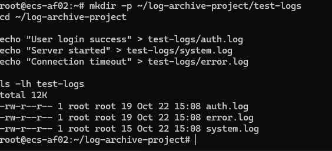
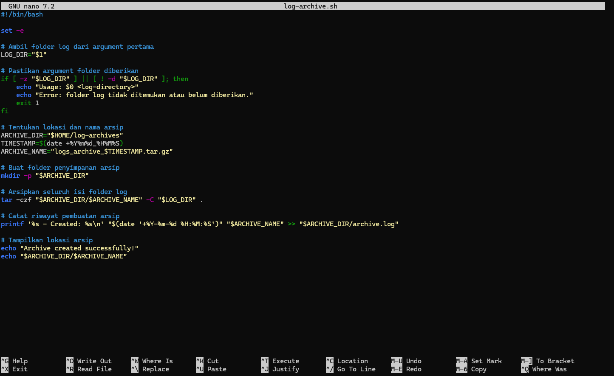
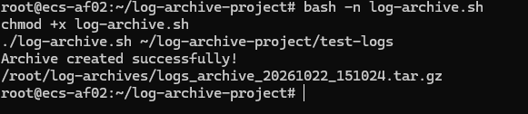
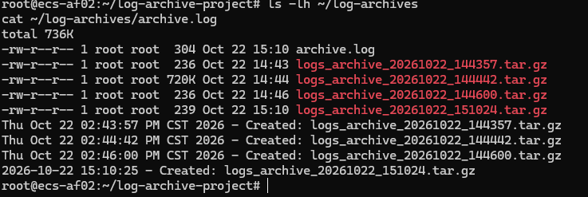

# Project 02 — Log Archive Tool

## 1. Overview

**What:**  
Project ini membuat Bash Script untuk mengumpulkan file log dari folder tertentu di server Linux, lalu mengompres dan menyimpannya menjadi satu file arsip `.tar.gz`.

**Why:**  
File log dapat terus bertambah seiring aktivitas server. Dengan membuat arsip terkompresi, kita bisa menyimpan riwayat log untuk troubleshooting dan analisis masalah di kemudian hari. Pengarsipan tidak otomatis menghapus log asli atau mengosongkan disk.

**Objectives:**
- Create a Bash script to archive log files.
- Accept a log directory as a command-line argument.
- Compress logs into a `.tar.gz` file.
- Store archives in a separate directory.
- Record archive timestamps in a log file.

## 2. Environment

| Resource | Configuration |
|---|---|
| Cloud Provider | Huawei Cloud |
| Region | AP-Jakarta |
| Service | Elastic Cloud Server (ECS) |
| Operating System | Ubuntu 24.04 LTS |
| Instance Specification | 1 vCPU / 1 GiB RAM |
| Programming Language | Bash |
| Script | `log-archive.sh` |

## 3. How It Works

Bash membaca perintah di dalam script dan menjalankan command Linux. Dalam project ini, script menerima lokasi folder log, membuat nama arsip berdasarkan tanggal dan waktu, lalu mengompres isi folder dengan `tar`.

**Workflow:**

1. User menjalankan script dengan memasukkan lokasi folder log.
2. Bash mengambil argument folder menggunakan `$1`.
3. Script membuat folder penyimpanan dan nama arsip berdasarkan timestamp.
4. `tar` menggabungkan serta mengompres isi folder log menjadi `.tar.gz`.
5. File arsip disimpan, lalu prosesnya dicatat pada `archive.log`.

```text
Folder log (test-logs/)
         |
         v
   log-archive.sh
         |
         v
   tar + gzip (.tar.gz)
         |
         v
  ~/log-archives/
  ├── logs_archive_YYYYMMDD_HHMMSS.tar.gz
  └── archive.log
```

## 4. Underneath — Technical Concepts

| Command / Concept | Purpose |
|---|---|
| `tar` | Menggabungkan file menjadi arsip; opsi `-z` memakai gzip untuk kompresi |
| `gzip` | Mengompres data agar ukuran arsip lebih kecil jika data memungkinkan |
| `date` | Mengambil tanggal dan waktu untuk nama arsip |
| `mkdir -p` | Membuat folder archive jika belum ada |
| `ls` | Melihat daftar file dan folder |
| `chmod +x` | Memberikan izin eksekusi pada script |
| `$1` | Mengambil argument pertama saat script dijalankan |
| `>>` | Menambahkan catatan ke akhir file tanpa menghapus isi sebelumnya |
| `cron` (optional) | Menjalankan script otomatis sesuai jadwal |

**Technical Understanding:**

- **Log archiving:** Menyimpan kumpulan log ke dalam satu arsip untuk dibuka kembali saat dibutuhkan.
- **Compression:** Menggunakan gzip melalui `tar -z` untuk mengurangi ukuran data yang disimpan.
- **Timestamp:** Membuat nama file berbeda sesuai waktu pengarsipan.
- **File permission:** `chmod +x` memungkinkan script dijalankan dengan `./log-archive.sh`.
- **Argument:** `$1` membuat kita bisa memilih folder log tanpa mengubah script.

## 5. Setup & Usage

### Step 1 — Prepare the Environment

Saya mengakses ECS menggunakan SSH, kemudian membuat folder project dan log percobaan.

```bash
ssh root@<EIP>

mkdir -p ~/log-archive-project/test-logs
cd ~/log-archive-project

echo "User login success" > test-logs/auth.log
echo "Server started" > test-logs/system.log
echo "Connection timeout" > test-logs/error.log

ls -lh test-logs
```



### Step 2 — Create the Bash Script

Saya membuat script menggunakan editor `nano`.

```bash
nano log-archive.sh
```


### Step 3 — Execute the Script

```bash
bash -n log-archive.sh
chmod +x log-archive.sh
./log-archive.sh ~/log-archive-project/test-logs
```

### Step 4 — Verify the Archive

Periksa apakah file archive dan riwayat pengarsipannya sudah dibuat.

```bash
ls -lh ~/log-archives
cat ~/log-archives/archive.log
```

Untuk memeriksa isi arsip, gunakan nama file `.tar.gz` yang muncul pada hasil `ls`:

```bash
tar -tzf ~/log-archives/<nama-archive>.tar.gz
```

Ganti `<nama-archive>` dengan nama arsip yang benar; tanda `< >` adalah placeholder, bukan bagian dari nama file.


### Project Assigment
[https://roadmap.sh/projects/log-archive-tool](https://roadmap.sh/projects/log-archive-tool)